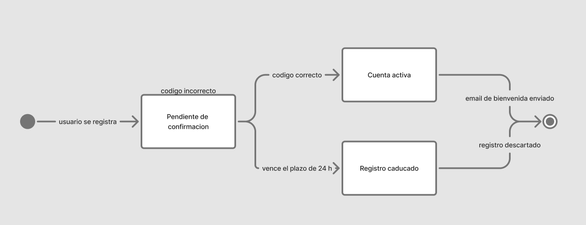
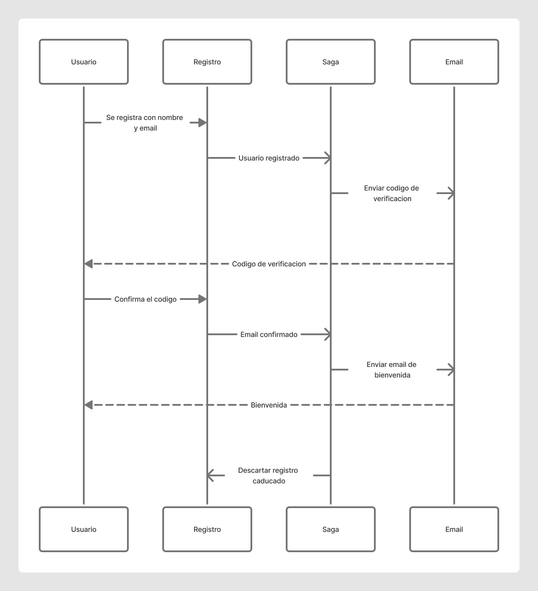
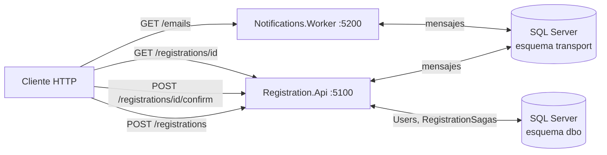
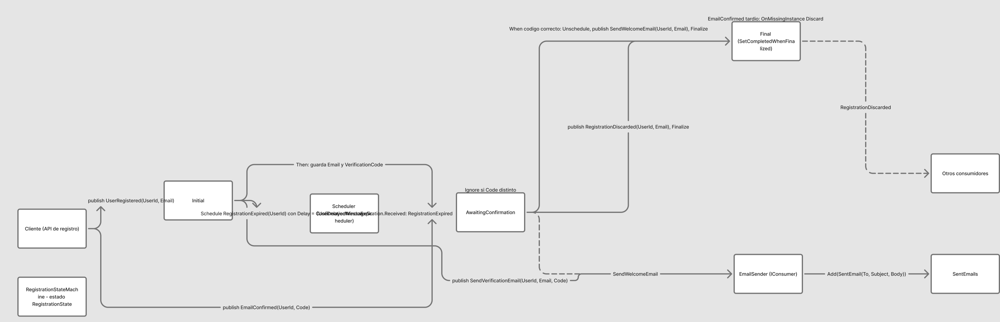
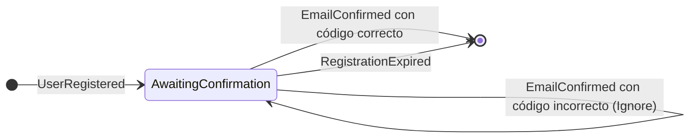

# MassTransit.Saga.Demo

Registro de usuario con confirmación de email implementado como **saga de MassTransit**, repartido en dos servicios .NET que hablan entre sí por **SQL Server como transporte de mensajes**. Sin RabbitMQ, sin Azure Service Bus, sin Docker: con la instancia local de SQL Server basta para arrancarlo, depurarlo con dos procesos en paralelo y ver las colas y el estado de la saga en tablas.

Es un ejemplo pequeño a propósito, pero completo: API con comandos y consultas (MediatR, vertical slice), validación (FluentValidation), respuestas tipadas (Ardalis.Result), entidad de dominio persistida (EF Core), máquina de estados con plazo (MassTransit) y un segundo servicio que consume los comandos de correo.

- [Qué hace, en términos de negocio](#qué-hace-en-términos-de-negocio)
- [Arquitectura](#arquitectura)
- [La saga paso a paso](#la-saga-paso-a-paso)
- [Mensajes](#mensajes)
- [Persistencia](#persistencia)
- [SQL Server como transporte](#sql-server-como-transporte)
- [La API: comandos, consultas, validación y resultados](#la-api-comandos-consultas-validación-y-resultados)
- [El worker de notificaciones](#el-worker-de-notificaciones)
- [Cómo ejecutarlo](#cómo-ejecutarlo)
- [Cómo depurarlo de verdad](#cómo-depurarlo-de-verdad)
- [Tests](#tests)
- [Ventajas e inconvenientes de la saga](#ventajas-e-inconvenientes-de-la-saga)
- [Decisiones de diseño](#decisiones-de-diseño)
- [Versiones y licencias](#versiones-y-licencias)

## Qué hace, en términos de negocio

Alguien se registra con su correo. A partir de ahí pasan cosas en momentos distintos, y el sistema tiene que acordarse de en qué punto está cada persona:

1. **Al instante** se le envía un correo con un código de verificación de seis dígitos y el registro queda *pendiente de confirmar*.
2. **Cuando la persona quiera** introduce el código. Si es el correcto, la cuenta pasa a *activa* y recibe el correo de bienvenida. Si se equivoca, puede volver a intentarlo.
3. **Si pasa el plazo** (24 horas en producción, 2 minutos en esta demo) sin confirmar, el registro caduca y se descarta: el usuario desaparece como si nunca se hubiera registrado. Un código introducido después ya no hace nada.



Ejemplo concreto: Ana se registra el lunes a las 10:00 y recibe el código 826925. Si lo introduce a las 18:00, su cuenta queda activa y le llega la bienvenida. Si lo introduce el miércoles, ya no hay registro: tiene que empezar de nuevo.



Los tres diagramas de este README están también en FigJam, editables: [Saga de registro de usuario](https://www.figma.com/board/iKgAEJdZhUd8wiztAhA4ro).

## Arquitectura

Dos servicios y una base de datos. La base hace tres papeles a la vez: guarda los usuarios, guarda el estado de las sagas y hace de cola de mensajes (esquema `transport`).



### Proyectos

| Proyecto | Capa | Qué contiene | Depende de |
|---|---|---|---|
| `Registration.Messages` | Contratos entre servicios | Los siete `record` que viajan por el bus | nada |
| `Registration.Domain` | Dominio | `User` (agregado), `UserStatus`, `RegistrationState` (instancia de la saga), `VerificationCode` | `MassTransit.Abstractions` (solo la interfaz `SagaStateMachineInstance`) |
| `Registration.Application` | Aplicación | La máquina de estados, los consumidores que cambian usuarios, los *features* (comando o consulta + handler + validador), el `ValidationBehavior`, las abstracciones de persistencia | Domain, Messages, MassTransit, MediatR, FluentValidation, Ardalis.Result |
| `Registration.Infrastructure` | Infraestructura | `RegistrationDbContext` (EF Core), repositorio de usuarios, lector de sagas, configuración de MassTransit con transporte SQL y repositorio EF de sagas | Application, EF Core SQL Server, MassTransit.EntityFrameworkCore, MassTransit.SqlTransport.SqlServer |
| `Registration.Api` | Presentación | Un endpoint por *feature* que delega en MediatR y traduce el `Result` a HTTP | Application, Infrastructure |
| `Notifications.Worker` | Otro servicio | `EmailSender` consume los comandos de correo y los apunta; `GET /emails` para leerlos | Messages, MassTransit |

### Capas y vertical slice a la vez

La aplicación está organizada por **capas** (dominio, aplicación, infraestructura, API) y, dentro de la capa de aplicación, por **features** verticales:

```
Registration.Application/
  Features/
    RegisterUser/      RegisterUserCommand, RegisterUserCommandValidator, RegisterUserCommandHandler
    ConfirmEmail/      ConfirmEmailCommand, ConfirmEmailCommandValidator, ConfirmEmailCommandHandler
    GetRegistration/   GetRegistrationQuery, GetRegistrationQueryHandler, RegistrationStatus
  Saga/                RegistrationStateMachine, RegistrationOptions
  Consumers/           UserActivatedConsumer, RegistrationDiscardedConsumer
  Behaviors/           ValidationBehavior
  Abstractions/        IUserRepository, IRegistrationReader
Registration.Api/
  Features/
    RegisterUser/      RegisterUserEndpoint
    ConfirmEmail/      ConfirmEmailEndpoint
    GetRegistration/   GetRegistrationEndpoint
```

Convención de nombres: `XCommand` / `XCommandHandler` / `XCommandValidator` y `XQuery` / `XQueryHandler`. Cada carpeta de `Features` tiene todo lo que necesita leer quien toca esa operación; el endpoint vive en la API con el mismo nombre de carpeta porque es lo único que sabe de HTTP.

## La saga paso a paso

Una saga de MassTransit es una **máquina de estados con instancia persistida**: por cada registro en curso hay una fila con su estado, y cada mensaje que llega la hace avanzar. Cuando termina, la fila se borra.





El corazón está en `Registration.Application/Saga/RegistrationStateMachine.cs`:

```csharp
Initially(
    When(UserRegistered)
        .Then(context => context.Saga.Start(context.Message.Email, DateTime.UtcNow))
        .Schedule(Expiration, context => new RegistrationExpired(context.Saga.CorrelationId))
        .Publish(context => new SendVerificationEmail(context.Saga.CorrelationId, context.Saga.Email, context.Saga.VerificationCode))
        .TransitionTo(AwaitingConfirmation));

During(AwaitingConfirmation,
    When(EmailConfirmed, context => context.Saga.Accepts(context.Message.Code))
        .Unschedule(Expiration)
        .Publish(context => new UserActivated(context.Saga.CorrelationId))
        .Publish(context => new SendWelcomeEmail(context.Saga.CorrelationId, context.Saga.Email))
        .Finalize(),
    Ignore(EmailConfirmed, context => !context.Saga.Accepts(context.Message.Code)),
    When(Expiration.Received)
        .Publish(context => new RegistrationDiscarded(context.Saga.CorrelationId, context.Saga.Email))
        .Finalize());

SetCompletedWhenFinalized();
```

Qué hace cada pieza:

- **`Initially` / `When(UserRegistered)`**: el primer evento crea la instancia. `CorrelateById(UserId)` hace que el id del usuario sea el id de la saga, así cualquier mensaje posterior con ese `UserId` encuentra su instancia.
- **`Then`**: la instancia guarda el correo, genera el código (`RandomNumberGenerator`, no `Random`) y la fecha. La lógica vive en `RegistrationState.Start`, en el dominio.
- **`Schedule(Expiration, ...)`**: programa un mensaje `RegistrationExpired` para dentro de `ConfirmationWindow`. El *token* del mensaje programado se guarda en la instancia (`ExpirationTokenId`) para poder cancelarlo. Quien lo entrega a su hora es el *scheduler* del transporte SQL.
- **`Publish(SendVerificationEmail)`**: la saga no envía correos; publica un comando que consume el worker.
- **`When(EmailConfirmed, filtro)`**: el código correcto cancela el plazo (`Unschedule`), publica `UserActivated` (lo consume la propia API para marcar al usuario como activo) y `SendWelcomeEmail`, y termina (`Finalize`).
- **`Ignore(EmailConfirmed, filtro contrario)`**: un código incorrecto no mueve la saga. Sin esta línea MassTransit lanzaría `UnhandledEventException` y el mensaje acabaría en la cola de error. Es a propósito que la API responda 200 en ese caso: la API no sabe el código; el que decide es la saga.
- **`When(Expiration.Received)`**: vence el plazo, publica `RegistrationDiscarded` (lo consume la API para borrar al usuario) y termina.
- **`OnMissingInstance(Discard)`** en `EmailConfirmed`: una confirmación cuando la saga ya terminó (caducada o ya activa) se descarta en silencio en vez de ir a la cola de error.
- **`SetCompletedWhenFinalized()`**: al llegar al estado `Final` la fila se borra. El resultado del proceso no está en la saga sino en el usuario (`Active`) o en su ausencia.

El plazo está en configuración: `Registration:ConfirmationWindow` en `appsettings.json` de la API (`00:02:00` en la demo). Los tests lo bajan a 2 segundos.

## Mensajes

Todos en `Registration.Messages`, inmutables, con el `UserId` como primera propiedad porque es la clave de correlación.

| Mensaje | Tipo | Quién lo publica | Quién lo consume |
|---|---|---|---|
| `UserRegistered(UserId, Email)` | evento | `RegisterUserCommandHandler` | la saga (la crea) |
| `SendVerificationEmail(UserId, Email, Code)` | comando | la saga | `EmailSender` (worker) |
| `EmailConfirmed(UserId, Code)` | evento | `ConfirmEmailCommandHandler` | la saga |
| `RegistrationExpired(UserId)` | mensaje programado | la saga, vía scheduler | la saga |
| `UserActivated(UserId)` | evento | la saga | `UserActivatedConsumer` (API) |
| `SendWelcomeEmail(UserId, Email)` | comando | la saga | `EmailSender` (worker) |
| `RegistrationDiscarded(UserId, Email)` | evento | la saga | `RegistrationDiscardedConsumer` (API) |

Eventos en pasado (algo ocurrió), comandos en imperativo (haz esto). La saga solo publica; nunca llama a nadie directamente.

## Persistencia

Un único `RegistrationDbContext` (hereda de `SagaDbContext` de MassTransit) con dos tablas en `dbo`:

| Tabla | Qué guarda | Quién la escribe |
|---|---|---|
| `Users` | El agregado `User`: `Id`, `Email` (único), `Status` (`PendingConfirmation` o `Active`, como texto), `CreatedAt`, `ActivatedAt` | `RegisterUserCommandHandler` (alta), `UserActivatedConsumer` (activación), `RegistrationDiscardedConsumer` (borrado) |
| `RegistrationSagas` | La instancia `RegistrationState`: `CorrelationId`, `CurrentState`, `Email`, `VerificationCode`, `ExpirationTokenId`, `RegisteredAt` | El repositorio de sagas de MassTransit (`EntityFrameworkRepository`, bloqueo pesimista con `UseSqlServer()`) |

El usuario existe desde el registro (por eso `POST /registrations` devuelve 201 y no 202), con estado pendiente. La saga orquesta su ciclo de vida a través de consumidores: no toca la tabla `Users` directamente. Los consumidores son idempotentes: activar a alguien ya activo o borrar a alguien ya borrado no hace nada, porque un mensaje puede entregarse dos veces.

Las tablas se crean con `EnsureCreated` al arrancar la API. Es una decisión de demo: **`EnsureCreated` no migra**. Si cambias el modelo, borra la base (`DROP DATABASE MassTransitSagaDemo`) y vuelve a arrancar. En un proyecto real irían migraciones de EF Core.

## SQL Server como transporte

MassTransit 8 incluye un transporte que usa SQL Server (o PostgreSQL) como broker: las colas son tablas, la entrega usa `UPDATE ... OUTPUT` con bloqueos, y el *scheduler* de mensajes diferidos viene incluido. Lo configura `Registration.Infrastructure/DependencyInjection.cs`:

```csharp
services.AddOptions<SqlTransportOptions>().Configure(options =>
{
    options.ConnectionString = connectionString;
    options.Schema = "transport";
    options.Role = "transport";
});
services.AddSqlServerMigrationHostedService(options =>
{
    options.CreateDatabase = false;
    options.CreateSchema = true;
    options.CreateInfrastructure = true;
});

services.AddMassTransit(x =>
{
    x.AddSqlMessageScheduler();
    x.AddConsumer<UserActivatedConsumer>();
    x.AddConsumer<RegistrationDiscardedConsumer>();
    x.AddSagaStateMachine<RegistrationStateMachine, RegistrationState>()
        .EntityFrameworkRepository(r =>
        {
            r.ExistingDbContext<RegistrationDbContext>();
            r.UseSqlServer();
        });
    x.UsingSqlServer((context, cfg) =>
    {
        cfg.UseSqlMessageScheduler();
        cfg.ConfigureEndpoints(context);
    });
});
```

Al arrancar aparecen en el esquema `transport` las tablas `Queue`, `Message`, `MessageDelivery`, `Topic`, `TopicSubscription`, `QueueSubscription`, `QueueMetric` y `QueueMetricCapture`. Cada consumidor y la saga tienen su cola (`EmailSender`, `UserActivated`, `RegistrationDiscarded`, `RegistrationState`); cada tipo de mensaje tiene su *topic*, y `Publish` reparte por suscripción. Los dos servicios comparten base, esquema y rol, así que se ven.

**Trampa con autenticación integrada.** El migrador del transporte, en el paso de crear la base, ejecuta siempre `CREATE LOGIN {Username} WITH PASSWORD = '{Password}'`. Con autenticación de Windows no hay `Username`, y el SQL resultante (`CREATE LOGIN  WITH PASSWORD`) falla con *Incorrect syntax near the keyword 'WITH'*. En cambio el paso de esquema sí resuelve el usuario actual con `ORIGINAL_LOGIN()` y le concede el rol. Por eso la base la crea EF (`EnsureCreated`, antes de que arranquen los *hosted services*) y el migrador va con `CreateDatabase = false`. Consecuencia: el worker necesita que la base exista, así que la API arranca primero.

¿Por qué SQL y no RabbitMQ? Porque es lo que hay en la máquina, y porque para depurar es una ventaja: `SELECT * FROM transport.Message` enseña los mensajes en vuelo con su cuerpo JSON, y `transport.MessageDelivery` los programados con su `EnqueueTime`. En producción el transporte SQL es una opción válida para volúmenes moderados; con mucho tráfico un broker dedicado rinde más.

## La API: comandos, consultas, validación y resultados

Tres endpoints, cada uno en su carpeta de `Registration.Api/Features`, que solo hacen dos cosas: `mediator.Send(...)` y `result.ToMinimalApiResult()`.

| Método y ruta | Comando o consulta | Respuestas |
|---|---|---|
| `POST /registrations` `{ "email": "..." }` | `RegisterUserCommand` → `Result<Guid>` | 201 con `Location: /registrations/{id}` y el id; 400 si el correo no es válido |
| `POST /registrations/{id}/confirm` `{ "code": "123456" }` | `ConfirmEmailCommand` → `Result` | 200 si se aceptó para que la saga lo evalúe (aunque el código esté mal); 400 si el código no son seis dígitos; 404 si el usuario no existe; 409 si ya está activo |
| `GET /registrations/{id}` | `GetRegistrationQuery` → `Result<RegistrationStatus>` | 200 con usuario y estado de la saga (`sagaState` es `null` cuando la saga terminó); 404 si no existe o fue descartado |

### MediatR

Cada *feature* es un `IRequest<Result<...>>` y un `IRequestHandler`. Los handlers no conocen HTTP: reciben el comando, hablan con el repositorio y publican en el bus con `IPublishEndpoint`. MediatR 12 (la 13 pasó a licencia comercial).

### FluentValidation en el pipeline

Los validadores viven junto a su comando (`RegisterUserCommandValidator`, `ConfirmEmailCommandValidator`) y se registran por ensamblado. `ValidationBehavior<TRequest, TResponse>` es un `IPipelineBehavior` de MediatR que ejecuta todos los validadores del comando antes del handler. Si alguno falla, **no lanza una excepción**: devuelve `Result.Invalid(errores)`, que el endpoint convierte en un 400 con los errores por propiedad. El handler ni se ejecuta.

```csharp
return errors.Count == 0
    ? await next(cancellationToken)
    : (TResponse)Invalid.Invoke(null, [errors])!;
```

El `Invoke` por reflexión existe porque `Result` y `Result<T>` son tipos distintos y cada uno tiene su propio `Invalid` estático; se resuelve una vez por tipo cerrado y se cachea en un campo estático.

### Ardalis.Result

Los handlers devuelven `Result` o `Result<T>` con un estado semántico (`Ok`, `Created`, `Invalid`, `NotFound`, `Conflict`...). `Ardalis.Result.AspNetCore` traduce ese estado al código HTTP con `ToMinimalApiResult()`, así los endpoints no tienen `if`s de códigos de estado ni los handlers lanzan excepciones para casos de negocio. `Ardalis.Result.FluentValidation` convierte los fallos de FluentValidation en `ValidationError` con el nombre de la propiedad.

## El worker de notificaciones

`Notifications.Worker` es el segundo proceso. Solo conoce `Registration.Messages`. `EmailSender` implementa `IConsumer<SendVerificationEmail>` e `IConsumer<SendWelcomeEmail>`: en vez de hablar con un proveedor de correo, apunta cada correo en memoria (`SentEmails`) y lo escribe en el log. `GET /emails` devuelve la lista, que es como se lee el código de verificación en la demo. Cambiar esto por un proveedor real no toca ni la saga ni la API.

## Cómo ejecutarlo

Requisitos: .NET 10 SDK y una instancia local de SQL Server con autenticación integrada (`Server=localhost`). La cadena de conexión está en los dos `appsettings.json`; no hay credenciales en el repo. Si tu instancia es otra, cámbiala ahí o pásala por variable de entorno `ConnectionStrings__Registration`.

```bash
dotnet build MassTransit.Saga.Demo.slnx
dotnet run --project src/Registration.Api          # http://localhost:5100, crea la base MassTransitSagaDemo
dotnet run --project src/Notifications.Worker      # http://localhost:5200, arrancar después de la API
```

El fichero `src/Registration.Api/Registration.Api.http` tiene el flujo completo para Visual Studio, Rider o la extensión REST Client. Con `curl`:

```bash
# 1. Registro: 201 y el id
curl -s -X POST http://localhost:5100/registrations -H "Content-Type: application/json" -d '{"email":"ana@example.com"}'
# "789e0000-a119-33e1-0572-08df367bcbc5"   (cabecera Location: /registrations/789e0000-...)

# 2. El código que "se envió"
curl -s http://localhost:5200/emails
# [{"to":"ana@example.com","subject":"Confirma tu email","body":"Tu código es 826925",...}]

# 3. Estado mientras espera
curl -s http://localhost:5100/registrations/789e0000-a119-33e1-0572-08df367bcbc5
# {"userStatus":"PendingConfirmation","sagaState":"AwaitingConfirmation",...}

# 4. Código incorrecto: 200, la saga lo ignora y sigue esperando
curl -s -X POST http://localhost:5100/registrations/789e0000-.../confirm -H "Content-Type: application/json" -d '{"code":"000000"}'

# 5. Código correcto: 200; el usuario pasa a Active, llega la bienvenida y la saga termina
curl -s -X POST http://localhost:5100/registrations/789e0000-.../confirm -H "Content-Type: application/json" -d '{"code":"826925"}'
curl -s http://localhost:5100/registrations/789e0000-...
# {"userStatus":"Active","sagaState":null,"activatedAt":"2026-10-30T11:49:11",...}
```

Si en vez de confirmar esperas los 2 minutos de `ConfirmationWindow`, el worker no recibe nada más, `RegistrationDiscardedConsumer` borra al usuario y `GET /registrations/{id}` pasa a 404.

## Cómo depurarlo de verdad

Es el motivo de que sean dos procesos y el transporte sea SQL:

1. **Dos instancias del depurador.** Arranca `Registration.Api` y `Notifications.Worker` con F5 (en Visual Studio, *Configure Startup Projects* con los dos; en Rider, una *Compound* configuration). Pon un breakpoint en `RegistrationStateMachine` (por ejemplo dentro del `Then` de `UserRegistered`), otro en `EmailSender.Consume` y otro en `UserActivatedConsumer.Consume`. Lanza el `POST /registrations` y verás saltar primero la saga en un proceso y después el consumidor en el otro.
2. **La cola en tablas.** Mientras estás parado en un breakpoint del worker, en SSMS:
   ```sql
   SELECT * FROM transport.Queue;                                  -- una fila por cola: EmailSender, RegistrationState, UserActivated, RegistrationDiscarded
   SELECT MessageType, Body FROM transport.Message;                -- mensajes en vuelo, con el JSON
   SELECT QueueId, EnqueueTime, DeliveryCount FROM transport.MessageDelivery ORDER BY EnqueueTime; -- el RegistrationExpired programado aparece aquí con EnqueueTime en el futuro
   SELECT CurrentState, Email, VerificationCode FROM dbo.RegistrationSagas;
   SELECT Email, Status, ActivatedAt FROM dbo.Users;
   ```
3. **El plazo.** `RegistrationExpired` queda en `MessageDelivery` con `EnqueueTime` dos minutos después del registro. Confirma y verás desaparecer esa fila (`Unschedule`). No confirmes y la verás entregarse, borrar al usuario y vaciar `RegistrationSagas`.
4. **Logs.** Los dos procesos escriben con nivel `Information` para `MassTransit`: endpoints configurados, bus arrancado, y cada correo "enviado" en el worker.
5. **Volver a empezar.** `DROP DATABASE MassTransitSagaDemo` (con `ALTER DATABASE ... SET SINGLE_USER WITH ROLLBACK IMMEDIATE` antes si hay conexiones) y arrancar la API.

## Tests

`dotnet test MassTransit.Saga.Demo.slnx` (unos 25 segundos; no necesita SQL Server).

| Proyecto | Qué prueba |
|---|---|
| `Registration.Domain.Tests` | `User`: nace pendiente, guarda correo y fecha, se activa una vez, no se activa dos veces |
| `Registration.Application.Tests` | La saga con el *test harness* en memoria de MassTransit: envía el código, espera confirmación, con código correcto publica `UserActivated` y `SendWelcomeEmail`, termina y cancela el plazo; con código incorrecto sigue esperando; al vencer publica `RegistrationDiscarded` y termina; una confirmación tardía no hace nada. Los validadores de los dos comandos. El `ValidationBehavior` con `Result` y `Result<T>` |

Trampas del *test harness* que condicionan cómo están escritos los tests:

- `Published.Select<T>()` **bloquea hasta el timeout de inactividad** (1,2 s por defecto). Por eso los tests leen el código de verificación de la instancia de la saga (`saga.Sagas.Contains(id).VerificationCode`) y no del mensaje publicado.
- `Published.Any<T>()` devuelve `false` al agotarse ese timeout. Los tests de caducidad esperan 2 s en silencio, así que `TestInactivityTimeout` se sube a plazo + 1 s.
- La saga publica dentro del comportamiento, **antes** de persistir la instancia. Una confirmación enviada justo después del registro puede no encontrar la saga y descartarse. Los tests esperan a `Exists(id, AwaitingConfirmation)` antes de confirmar. En producción esto se resuelve con el *outbox* transaccional de MassTransit.
- Los eventos ignorados con `Ignore` no aparecen en `Consumed` del harness de la saga; se usa el `Consumed` del bus.

## Ventajas e inconvenientes de la saga

Comparado con la alternativa habitual: un handler que registra al usuario y envía el correo, otro endpoint que confirma mirando la tabla de usuarios, y un *job* nocturno que borra los registros viejos.

Qué se gana:

- **Estado durable del proceso.** La fila de la saga dice en qué paso va cada registro. Si el servicio se cae a mitad, al volver sigue. Un handler síncrono que falla después de guardar y antes de enviar deja el registro a medias y nadie se entera.
- **Esperas y plazos sin código propio.** "Si en 24 h no confirma, descarta" es `Schedule` + `Unschedule`. Sin saga es un job programado, una columna de fecha y la pregunta de qué pasa si confirma justo mientras el job borra.
- **Cada paso es un mensaje pequeño y reintentable.** Si el proveedor de correo está caído, se reintenta solo `SendVerificationEmail`; el registro ya está hecho.
- **Desacoplamiento.** El worker de correo no sabe nada de registros ni de sagas; recibe "envía esto". Cambiar de proveedor, o añadir un SMS, no toca la saga ni la API.
- **Trazabilidad.** `GET /registrations/{id}` enseña el estado del proceso, no solo el del usuario. Soporte puede ver "lleva desde el martes esperando confirmación".
- **Decisiones en un solo sitio.** Si el código es correcto o no lo decide la saga, que es quien lo tiene; la API no necesita conocerlo y el código no viaja de vuelta.

Qué se paga:

- **Más piezas.** Un transporte, un repositorio de sagas, un scheduler, colas de error. Para dos pasos que caben en una transacción es demasiado.
- **Consistencia eventual.** Entre `POST /registrations` y el correo pasan milisegundos en los que el usuario existe pero la saga aún no. La interfaz tiene que saber mostrar "pendiente", y la API responde 200 a un código incorrecto porque la respuesta real llega después.
- **Idempotencia obligatoria.** Los mensajes pueden llegar dos veces o fuera de orden. Cada consumidor lo contempla (`UserActivatedConsumer` ignora a los ya activos).
- **Depuración distinta.** Un fallo no es una traza de pila en la petición; es un mensaje en `_error` y una saga parada en un estado. Hace falta mirar colas y tablas, no solo logs. Esta demo lo convierte en ventaja porque las colas son tablas, pero exige saber dónde mirar.
- **Publicación antes de persistir.** El mensaje sale antes de que la instancia esté guardada. Con el transporte en memoria de los tests se nota; en producción, el *outbox*.
- **Acoplamiento a la librería.** `MassTransitStateMachine` es un DSL propio; la máquina de estados no se mueve a otro framework sin reescribirla.

Regla práctica: saga cuando el proceso **espera** (a una persona, a otro sistema, a un plazo) o toca varios servicios con compensación. Handler normal cuando todo cabe en una transacción local.

## Decisiones de diseño

**Dos servicios, no tres.**
Problema: enseñar mensajería entre procesos sin inflar el ejemplo.
Alternativa descartada: un tercer servicio orquestador con la saga, separado de la API.
Qué se gana: la API es dueña del proceso de registro y aloja la saga; el worker es el "otro sistema". Un orquestador aparte solo tiene sentido cuando varias APIs alimentan el mismo proceso.

**La saga termina; el resultado vive en el usuario.**
Problema: los diagramas de negocio muestran dos finales (activa, caducada).
Alternativa descartada: estados terminales permanentes en la saga.
Qué se gana: `RegistrationSagas` solo contiene procesos en curso y no crece sin límite. El resultado está donde debe: `Users.Status = Active`, o ninguna fila.

**El usuario se persiste al registrarse, no al confirmar.**
Problema: `GET /registrations/{id}` tenía que responder algo mientras la saga espera.
Alternativa descartada: crear el usuario solo al confirmar, dejando el correo únicamente en la saga.
Qué se gana: hay un agregado de dominio real con ciclo de vida (`PendingConfirmation` → `Active`), la API devuelve 201 con recurso, y se ve el patrón completo: la saga orquesta y los consumidores mutan el dominio.

**La saga no toca la base de usuarios; publica `UserActivated` y `RegistrationDiscarded`.**
Problema: alguien tiene que activar o borrar al usuario.
Alternativa descartada: inyectar `IUserRepository` en la máquina de estados.
Qué se gana: la saga solo coordina mensajes. Los consumidores son pequeños, idempotentes y están donde está el repositorio. Otro servicio podría suscribirse a los mismos eventos sin tocar la saga.

**Validación como `Result.Invalid`, no como excepción.**
Problema: FluentValidation suele usarse lanzando `ValidationException` y un middleware que la convierte en 400.
Alternativa descartada: ese middleware.
Qué se gana: un único camino de respuesta. El endpoint traduce cualquier `Result` igual; no hay excepciones para flujo de negocio ni un handler global que conozca tipos de excepción.

**`EnsureCreated` en vez de migraciones.**
Problema: la demo tiene que arrancar sin pasos previos.
Alternativa descartada: `dotnet ef migrations` y aplicarlas al arrancar.
Qué se gana: cero configuración. Se paga con la nota de "borra la base si cambias el modelo".

## Versiones y licencias

| Paquete | Versión | Nota |
|---|---|---|
| MassTransit, .EntityFrameworkCore, .SqlTransport.SqlServer, .Abstractions | 8.5.12 | La 9 pasó a licencia comercial; la 8.x sigue siendo Apache 2.0 |
| MediatR | 12.5.0 | La 13 pasó a licencia comercial |
| FluentValidation (+ DependencyInjectionExtensions) | 12.2.0 | Apache 2.0 |
| Ardalis.Result (+ AspNetCore, FluentValidation) | 10.1.0 | MIT |
| Microsoft.EntityFrameworkCore.SqlServer | 10.0.14 | |
| System.Security.Cryptography.Pkcs | 10.0.14 | Pin: el transporte SQL arrastra una 9.0.11 con aviso de seguridad |

Versiones centralizadas en `Directory.Packages.props`.
